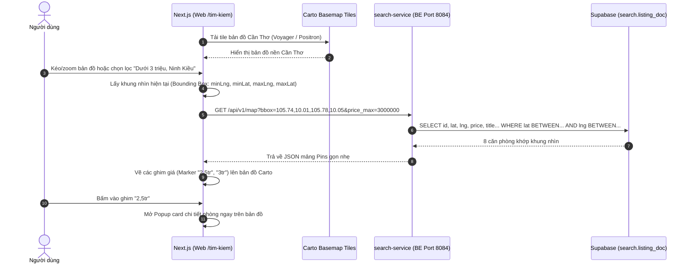
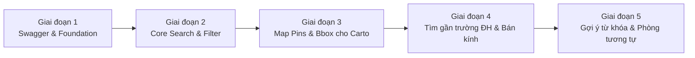

# Kế Hoạch Triển Khai Search Service & Tích Hợp Bản Đồ Carto

Tài liệu này tập trung 100% vào **kỹ thuật, kiến trúc phân tầng và phân chia giai đoạn thực hiện**, đặc biệt làm rõ cơ chế **Backend cung cấp tọa độ cho Frontend vẽ bản đồ qua API của CARTO**.

---

## 1. Cơ Chế Giao Tiếp Giữa Backend (Search Service) Và Frontend (Carto Map)

### 1.1 Bản chất của Carto và vai trò của từng bên

Nhiều người hay nhầm Carto là nơi lưu dữ liệu phòng. Thực tế:
* **Carto (Bản đồ nền - Basemap Tile):** Chỉ đóng vai trò cung cấp hình ảnh bản đồ (đường sá, sông ngòi, tòa nhà Cần Thơ) qua Carto Vector/Raster Tiles (nhẹ, đẹp, hiện đại, miễn phí).
* **Backend `search-service` (Dữ liệu nghiệp vụ):** Là nơi **sở hữu và tính toán toàn bộ tọa độ GPS (`lat`, `lng`), giá tiền, bộ lọc**.
* **Frontend Next.js (Khâu kết nối & hiển thị):** Lấy tile bản đồ từ Carto làm nền, sau đó gọi API của Backend để lấy danh sách tọa độ các phòng và **vẽ các ghim (Markers/Pins) đè lên bản đồ Carto**.



---

### 1.2 Thiết kế API Bản đồ (`GET /api/v1/map`)

Backend cung cấp endpoint riêng biệt để vẽ bản đồ, **tối ưu dung lượng cực nhẹ** (chỉ trả về thông tin cần để ghim và popup, không kèm mô tả dài):

#### A. Request Params
* `bbox`: Bounding Box tọa độ 4 góc của màn hình `minLng,minLat,maxLng,maxLat` (ví dụ: `105.74,10.01,105.78,10.05`).
* Kèm các bộ lọc đồng bộ với trang tìm kiếm: `price_min`, `price_max`, `room_type`, `district_id`, `amenities`...

#### B. Response JSON (Chuẩn để FE vẽ Map)
```json
{
  "total_pins": 6,
  "pins": [
    {
      "room_id": "01933002-xxxx-xxxx-xxxx-xxxxxxxxxxxx",
      "lat": 10.0315,
      "lng": 105.7665,
      "price": 2600000,
      "price_label": "2,6 tr",
      "title": "Minihouse Gác Cao Hẻm 51 Hồ Bún Xáng",
      "project_name": "TTHome Cổng B ĐHCT",
      "room_slug": "xuan-khanh-ninh-kieu-ctu-hem51-p101",
      "thumbnail_url": "https://images.unsplash.com/...",
      "room_type": "duplex",
      "has_balcony": false,
      "pet_policy": "allowed"
    }
  ]
}
```

#### C. Cách Frontend sử dụng Carto để vẽ:
FE dùng thư viện **MapLibre GL** (hoặc Leaflet) kết hợp Carto Basemap:
```typescript
// Nguồn Tile miễn phí từ Carto:
// https://basemaps.cartocdn.com/rastertiles/voyager/{z}/{x}/{y}.png (sáng, trẻ trung)
// hoặc https://basemaps.cartocdn.com/rastertiles/dark_all/{z}/{x}/{y}.png (dark mode)

// Khi bản đồ dừng di chuyển (moveend):
map.on('moveend', async () => {
  const bounds = map.getBounds();
  const bbox = `${bounds.getWest()},${bounds.getSouth()},${bounds.getEast()},${bounds.getNorth()}`;
  
  // Gọi Backend lấy danh sách Pin
  const res = await fetch(`http://localhost:8084/api/v1/map?bbox=${bbox}&price_max=3000000`);
  const { pins } = await res.json();
  
  // Render Marker ghim giá tiền lên tọa độ lat/lng
  renderMarkers(pins);
});
```

---

## 2. Cấu Trúc Code Backend (`search-service`)

Tuân thủ nghiêm ngặt **Mục 11 của `.claude/CLAUDE.md`** (Mỗi dịch vụ phải có Interface và đặt trong package riêng cùng tên):

```text
backend/services/search-service/src/main/java/vn/tthome/search/
├── config/
│   ├── OpenApiConfig.java               # Cấu hình Swagger UI (cho bạn test trực quan)
│   └── WebCorsConfig.java               # Mở CORS cho Frontend Next.js gọi API
├── commons/
│   ├── QueryNormalizer.java             # Chuẩn hóa tiếng Việt không dấu (vd: "cần thơ" -> "can tho")
│   └── GeoUtils.java                    # Hỗ trợ phân tích chuỗi Bounding Box bbox
├── models/
│   ├── entities/
│   │   └── ListingDoc.java              # Ánh xạ bảng phẳng search.listing_doc
│   ├── dtos/
│   │   ├── SearchFilterRequest.java     # Nhận tham số tìm kiếm, lọc giá, tiện nghi, phân trang
│   │   ├── SearchResponse.java          # Trả về danh sách phòng kèm tổng số trang, phân trang
│   │   ├── SuggestItemResponse.java     # DTO gợi ý tìm kiếm
│   │   ├── MapPinResponse.java          # DTO ghim bản đồ (lat, lng, giá, thumbnail)
│   │   └── NearbyResponse.java          # DTO tìm gần địa danh (kèm khoảng cách distance_km)
│   └── enums/
│       ├── SortOption.java              # NEWEST, PRICE_ASC, PRICE_DESC, POPULAR...
│       └── RoomType.java                # STUDIO, DUPLEX, ONE_BED, TWO_BED...
├── repos/listingdoc/
│   ├── ListingDocRepository.java        # Interface Repository
│   └── impl/
│       └── ListingDocRepositoryImpl.java# Xây dựng câu SQL động bằng JdbcClient
├── services/                            # MỖI NGHIỆP VỤ CÓ INTERFACE + IMPL RIÊNG
│   ├── search/
│   │   ├── SearchService.java
│   │   └── impl/SearchServiceImpl.java
│   ├── map/
│   │   ├── MapService.java
│   │   └── impl/MapServiceImpl.java
│   ├── nearby/
│   │   ├── NearbyService.java
│   │   └── impl/NearbyServiceImpl.java
│   ├── suggest/
│   │   ├── SuggestService.java
│   │   └── impl/SuggestServiceImpl.java
│   └── similar/
│       ├── SimilarRoomService.java
│       └── impl/SimilarRoomServiceImpl.java
└── controllers/
    ├── SearchController.java            # GET /api/v1/search
    ├── MapController.java               # GET /api/v1/map
    ├── NearbyController.java            # GET /api/v1/nearby
    ├── SuggestController.java           # GET /api/v1/suggest
    └── SimilarController.java           # GET /api/v1/rooms/{id}/similar
```

---

## 3. Phân Chia Các Giai Đoạn Triển Khai (Progressive Stages)

Kế hoạch được chia thành **5 giai đoạn rõ ràng**, giai đoạn sau kế thừa dữ liệu và chức năng của giai đoạn trước:



---

### 🟢 Giai đoạn 1: Swagger UI & Mô Hình Dữ Liệu Nền Tảng
* **Mục tiêu:** Cài đặt Swagger UI để bạn và đồng đội test trực tiếp trên trình duyệt, tạo sẵn các Model/Entity.
* **Chi tiết công việc:**
  1. Thêm dependency `springdoc-openapi-starter-webmvc-ui` vào `search-service/pom.xml`.
  2. Viết `OpenApiConfig`: Cấu hình tiêu đề "TTHome Cần Thơ - Search API", phiên bản 1.0.
  3. Tạo Entity `ListingDoc` ánh xạ bảng `search.listing_doc`.
  4. Tạo các Enum (`SortOption`, `RoomType`) và tiện ích `QueryNormalizer` (xóa dấu tiếng Việt).
* **Kết quả nghiệm thu:** Khởi động service và mở `http://localhost:8084/swagger-ui.html` thấy giao diện Swagger UI sẵn sàng.

---

### 🟢 Giai đoạn 2: API Tìm Kiếm & Bộ Lọc Nâng Cao (`/api/v1/search`)
* **Mục tiêu:** Tính năng cốt lõi cho trang danh sách phòng: tìm theo từ khóa, lọc theo giá Cần Thơ, quận/phường, tiện nghi.
* **Chi tiết công việc:**
  1. Tạo `SearchFilterRequest` nhận: `q` (từ khóa), `price_min`, `price_max`, `district_id`, `ward_id`, `room_type`, `amenities`, `sort`, `page`, `limit`.
  2. Viết `ListingDocRepositoryImpl` sử dụng **`JdbcClient`** dựng câu truy vấn SQL động:
     * Tìm từ khóa: `doc_text ILIKE :q` hoặc full-text search `tsv @@ plainto_tsquery('simple', :q)`.
     * Khoảng giá: `price BETWEEN :min AND :max`.
     * Khu vực: `district_id = :districtId` (Ninh Kiều / Cái Răng...).
     * Loại phòng: `room_type IN (:types)`.
     * Mảng tiện nghi: `amenity_ids @> :amenityArray` (PostgreSQL array contains).
     * Lối tắt: `pet_policy != 'none'`, `ev_parking = true`, `is_promo = true`.
     * Sắp xếp: Giá tăng/giảm (`ORDER BY price ASC/DESC`), Mới nhất (`listed_at DESC`).
     * Phân trang: `LIMIT :limit OFFSET :offset`.
  3. Viết `SearchService` (Interface) + `SearchServiceImpl` (Impl).
  4. Viết `SearchController`: endpoint `GET /api/v1/search`.
* **Kết quả nghiệm thu:** Bạn mở Swagger UI, nhập thử `price_max=3000000`, `room_type=duplex` ➡️ API trả về chính xác danh sách các phòng trọ có gác lửng dưới 3tr tại Cần Thơ.

---

### 🟢 Giai đoạn 3: API Cung Cấp Tọa Độ Bản Đồ Cho Carto (`/api/v1/map`)
* **Mục tiêu:** Cung cấp dữ liệu tọa độ ghim nhẹ nhất để Frontend ghép nối với bản đồ Carto.
* **Chi tiết công việc:**
  1. Tạo `MapPinResponse` (chỉ gồm: `room_id`, `lat`, `lng`, `price`, `title`, `slug`, `thumbnail_url`, `room_type`).
  2. Viết query lấy phòng trong khung nhìn Bounding Box của bản đồ:
     ```sql
     WHERE lat BETWEEN :south AND :north
       AND lng BETWEEN :west AND :east
       AND status = 'available'
     ```
  3. Viết `MapService` (Interface) + `MapServiceImpl` (Impl).
  4. Viết `MapController`: endpoint `GET /api/v1/map`.
* **Kết quả nghiệm thu:** Truyền tọa độ Cần Thơ vào Swagger (`bbox=105.70,10.00,105.80,10.08`), Swagger trả về mảng danh sách các điểm ghim GPS để FE dùng vẽ bản đồ.

---

### 🟢 Giai đoạn 4: API Tìm Gần Trường Đại Học & Bán Kính GPS (`/api/v1/nearby`)
* **Mục tiêu:** Phục vụ các nút bấm nhanh: "Gần ĐH Cần Thơ", "Gần ĐH Y Dược", "Gần FPT", "Gần Bến Ninh Kiều" hoặc theo vị trí người dùng.
* **Chi tiết công việc:**
  1. Sử dụng extension `earthdistance` của PostgreSQL để tính khoảng cách đường chim bay chính xác đến từng mét.
  2. Viết query tính khoảng cách và sắp xếp từ gần đến xa:
     ```sql
     SELECT *, (earth_distance(ll_to_earth(lat, lng), ll_to_earth(:centerLat, :centerLng))) / 1000.0 AS distance_km
     WHERE earth_box(ll_to_earth(:centerLat, :centerLng), :radiusMeters) @> ll_to_earth(lat, lng)
     ORDER BY distance_km ASC
     ```
  3. Viết `NearbyService` (Interface) + `NearbyServiceImpl` (Impl).
  4. Viết `NearbyController`: endpoint `GET /api/v1/nearby`.
* **Kết quả nghiệm thu:** Test Swagger tìm phòng quanh ĐH Cần Thơ trong bán kính 2km ➡️ Trả về các phòng Hẻm 51, Hồ Bún Xáng đầu tiên với `distance_km: 0.3 km`.

---

### 🟢 Giai đoạn 5: API Gợi Ý Tự Động & Phòng Tương Tự
* **Mục tiêu:** Hoàn thiện trải nghiệm người dùng cao cấp.
* **Chi tiết công việc:**
  1. API `GET /api/v1/suggest?q=...`: Gợi ý nhanh khi người dùng vừa gõ phím ô tìm kiếm (trả về tên dự án, tên đường, tên phường).
  2. API `GET /api/v1/rooms/{id}/similar`: Khi người dùng đang xem một phòng, gợi ý 4 phòng khác cùng khu vực, cùng loại phòng và giá chênh lệch không quá 20%.
* **Kết quả nghiệm thu:** Đầy đủ 5 cụm API xuất hiện gọn gàng trên Swagger UI.
